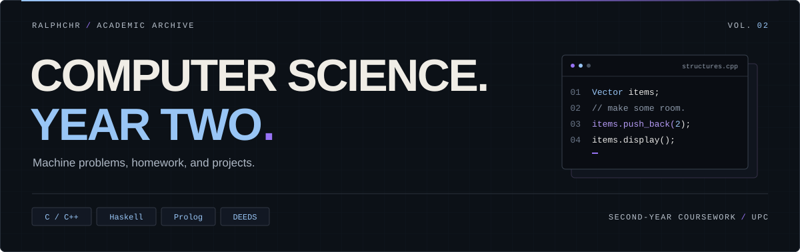
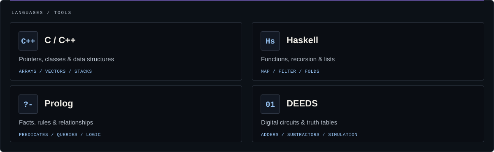
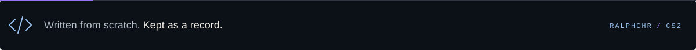

<div align="center">
  
</div>

<p align="center">
  <a href="#coursework">Coursework</a> &nbsp; / &nbsp;
  <a href="#toolkit">Toolkit</a> &nbsp; / &nbsp;
  <a href="#field-notes">Field notes</a>
</p>

A collection of machine problems, exercises, homework, and projects from my second year as a **Computer Science student at UPC**. This year: building data structures, trying different programming languages, and working with digital circuits.

<a name="coursework"></a>

## `01 /` Coursework

| | Collection | Focus | Stack |
| :--- | :--- | :--- | :--- |
| `01` | **[CMSC 123](CMSC%20123/)** | Searching & merging · classes · dynamic arrays · stacks | `C++` |
| `02` | **[CMSC 23](CMSC%2023/)** | Generic pointers · functional programming · facts & rules | `C` `Haskell` `Prolog` |
| `03` | **[CMSC 130](CMSC%20130/)** | Adders · subtractors · truth tables · circuit simulation | `DEEDS` |

### A few stops along the way

| Problem / project | What I worked on |
| :--- | :--- |
| **[BigNum & Fibonacci](CMSC%20123/MP3.cpp)** | Adding large numbers as strings and using them to compute Fibonacci numbers. |
| **[Vector](CMSC%20123/MP7.cpp)** | Building a resizable array with insertion, deletion, sorting checks, and duplicate removal. |
| **[Postfix evaluator](CMSC%20123/MP8.cpp)** | Using a stack to evaluate arithmetic expressions in postfix notation. |
| **[Functions & lists](CMSC%2023/MP3.hs)** | Writing map, filter, folds, zip, and function composition in Haskell. |
| **[Friends & enemies](CMSC%2023/MP4.pl)** | Describing relationships with Prolog facts and rules, then [querying them](CMSC%2023/MP4.txt). |
| **[Full adder](CMSC%20130/Borbon_Ralph_FullAdder.pbs)** | Building a digital circuit and recording its [truth table](CMSC%20130/Borbon_Ralph_FullAdder_TruthTable.jpg). |

<a name="toolkit"></a>

## `02 /` Toolkit



<a name="field-notes"></a>

## `03 /` Field notes

The solutions here are my own work, written from scratch as part of my second-year CS journey. They reflect my understanding and problem-solving approach **at the time I wrote them**. Some are rough around the edges; that's part of the record.

<details>
<summary><strong>Run an exercise</strong></summary>

Each folder contains separate exercises. Check the source comments and input handling for the expected format. Some files, such as the BigNum and mixed-fraction implementations, need a separate driver program; keep their matching headers beside them.

**C++** — compile a standalone exercise from the repository root:

```sh
g++ "CMSC 123/MP8.cpp" -o postfix
```

Run `./postfix` on macOS/Linux or `.\postfix.exe` in Windows PowerShell. Enter `3 4 + 2 *` to get `14.00`.

**C** — the logging functions in `CMSC 23/MP1.c` need a driver to run. Compile the file on its own to an object file with:

```sh
gcc -c "CMSC 23/MP1.c" -o logging.o
```

**Haskell** — load an exercise in GHCi:

```sh
ghci "CMSC 23/MP3.hs"
```

Try `sumOfSquares [1,2,3]`, which evaluates to `14`. Load `MP2.hs` separately for the earlier function exercises.

**Prolog** — load the knowledge base in SWI-Prolog:

```sh
swipl -s "CMSC 23/MP4.pl"
```

Try `enemies(A, B).` at the prompt. The accompanying `MP4.txt` contains queries and recorded results.

**Digital circuits** — open the `.pbs` files in DEEDS / Deeds-DcS. The `.jpg` files in the same folder contain the recorded truth tables.

</details>

<br>


